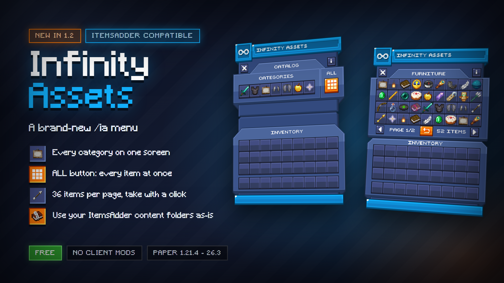
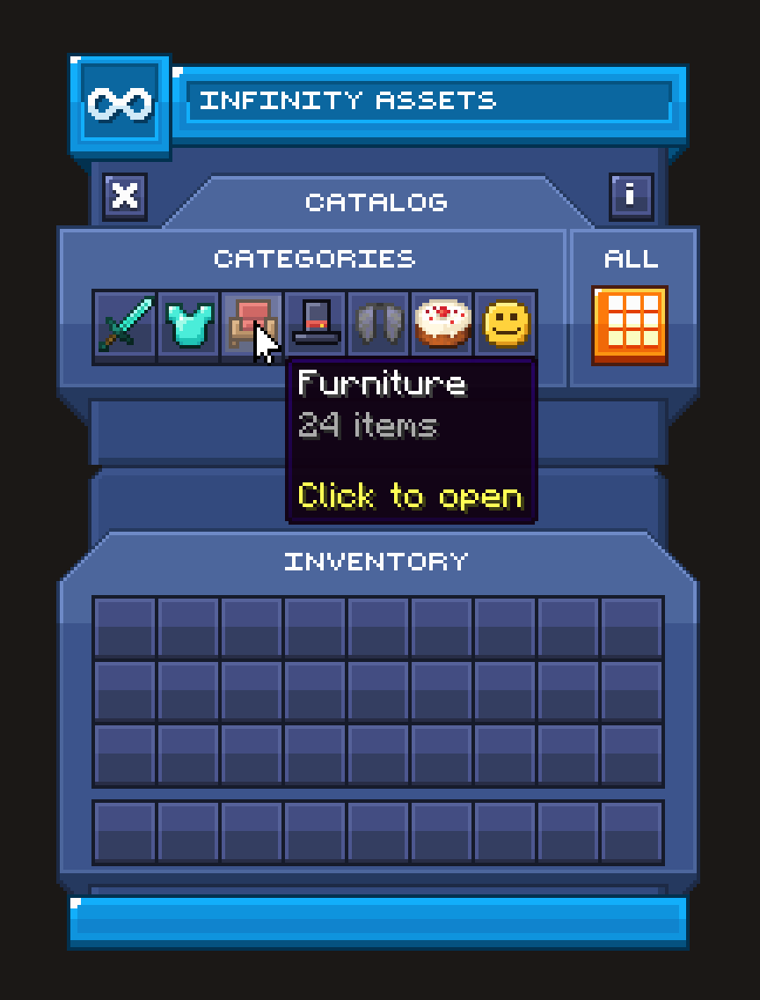
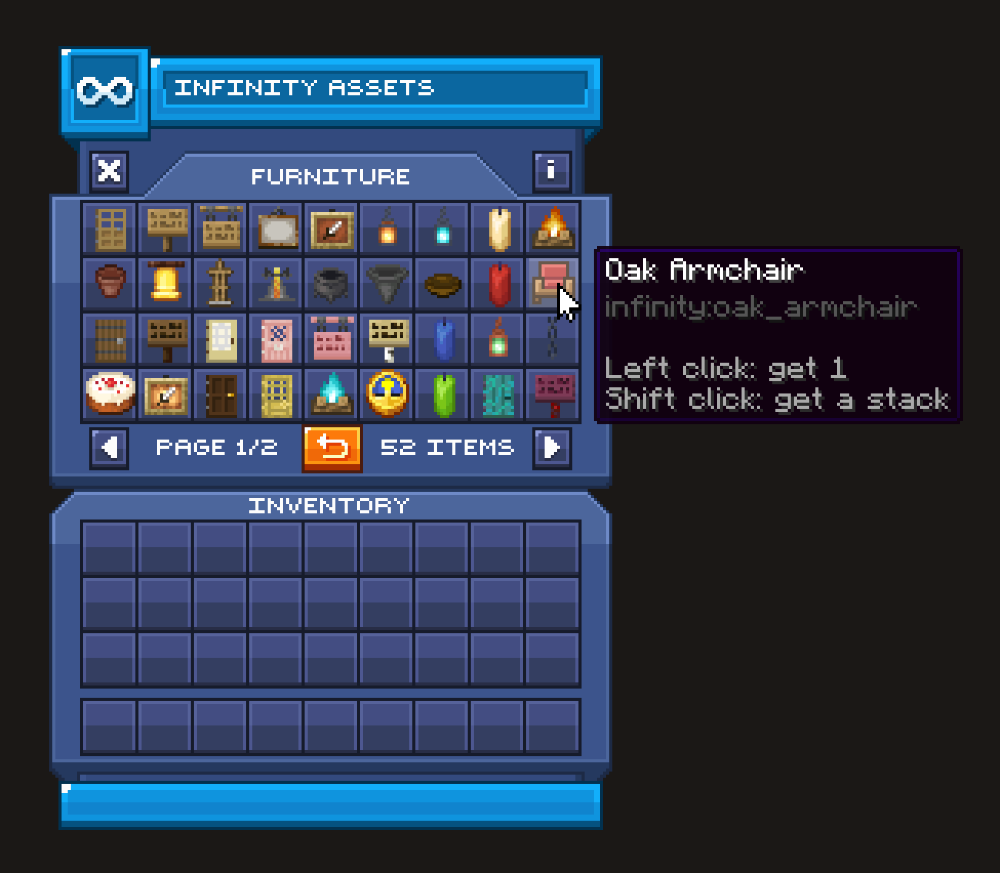

<p align="center">
  
</p>

<h1 align="center">InfinityAssets</h1>

<p align="center">
  <b>Custom items, armors, furniture and hats for Paper, using your ItemsAdder content folders as they are.</b><br>
  The plugin builds and hosts the resource pack for you. No client mods, and no ItemsAdder, Oraxen or Nexo needed.
</p>

<p align="center">
  <a href="https://modrinth.com/plugin/infinityassets"></a>
  <a href="https://www.spigotmc.org/resources/136246/"></a>
  
  
  <a href="https://discord.gg/edzKrjZ8hf"></a>
  <a href="LICENSE"></a>
</p>

---

## ✨ Features

| | |
|---|---|
| 🗡️ **Custom items** | Own models and textures, names, lore, custom durability, attributes, enchantments, item flags, glint, leather colors |
| 🏹 **Animated tools** | Bows, crossbows, shields and fishing rods keep their pulling, charged, blocking and cast states |
| 🛡️ **Custom armor** | Rendered on the player through equipment models |
| 🪑 **Furniture** | Display entities, solid with a hitbox or decorative, breakable, with place and break sounds |
| 🎩 **Hats** | Any custom item can be worn on the head |
| 😀 **Font images** | `:emoji:` in chat, item names and lore |
| 🔊 **Sounds** | Registered automatically from your packs |
| 🧪 **Recipes** | Crafting (shaped and shapeless), furnace, smoker, blast furnace, campfire and smithing |
| 📦 **Resource pack** | `/iazip` builds `generated.zip`, hosts it itself or uses your own URL, and merges packs from other plugins |
| 📂 **ItemsAdder format** | Drop your existing ItemsAdder `contents/` folders in and they load |

## 🧭 The /ia menu

`/ia` opens a textured menu that ships inside the generated resource pack: one screen with every category you created, an **ALL** button with every item, and a paged item list. Players who decline the resource pack get the same layout with plain buttons.

<p align="center">
  
  &nbsp;&nbsp;
  
</p>

- **Up to 14 categories per page**, more pages with an arrow
- **36 items per page**, previous / next and a back button
- **Left click** takes 1, **shift click** a stack (with `ia.user.ia.getitem` or `ia.admin.iaget`)
- Turn the texture off with `menu.custom-gui: false`

## 📥 Installation

1. Put `InfinityAssets-<version>.jar` in `plugins/` (Paper or Purpur **1.21.4 to 26.3**, Java 21).
2. Start the server once, then drop your content folders in `plugins/InfinityAssets/contents/`.
3. Run `/iazip`. Players get the resource pack when they join.

Set `resource-pack.hosting.self-host.server-ip` in `config.yml` to your public IP or domain so players can download the pack.

## ⌨️ Commands

| Command | What it does | Permission |
|---|---|---|
| `/ia [category] [player]` | Open the menu (or a category) | `ia.user.ia` (everyone) |
| `/iaget <item> [amount]` | Get a custom item | `ia.admin.iaget` |
| `/iagive <player> <item> [amount] [silent]` | Give a custom item | `ia.admin.iagive` |
| `/iazip` | Reload configs and build the resource pack | `ia.admin.iazip` |
| `/iareload` | Reload configs without building the pack | `ia.admin.iareload` |
| `/iatexture [all\|player]` | Send the resource pack again | `ia.user.iatexture` |
| `/iatag` | Show the id of the item in your hand | `ia.admin.iatag` |

## ⚙️ Menu settings

```yaml
menu:
  # Textured /ia menu (needs the generated resource pack). false = plain chest menu.
  custom-gui: true
  # Hide the "Inventory" label the game draws on chest menus (the texture has its own).
  hide-inventory-label: true
```

## 🧱 What is not supported yet

Real custom blocks, `events` / actions, guns, vehicles, sitting on furniture, music discs, trampolines, beds, connectable furniture, contact damage, custom drops, blocked enchants and fuel values. Configs that use them still load: the plugin reports each unsupported key once in the console.

## 🛠️ Building

```bash
./gradlew build
```

The plugin jar ends up in `build/libs/`. The tests build a full resource pack from a small synthetic ItemsAdder-format pack in `src/test/resources`.

## 📄 License

[MIT](LICENSE) © byebye_gg. Free to use, modify and share; keep the copyright notice. The plugin is also on [Modrinth](https://modrinth.com/plugin/infinityassets) and [Spigot](https://www.spigotmc.org/resources/136246/).
